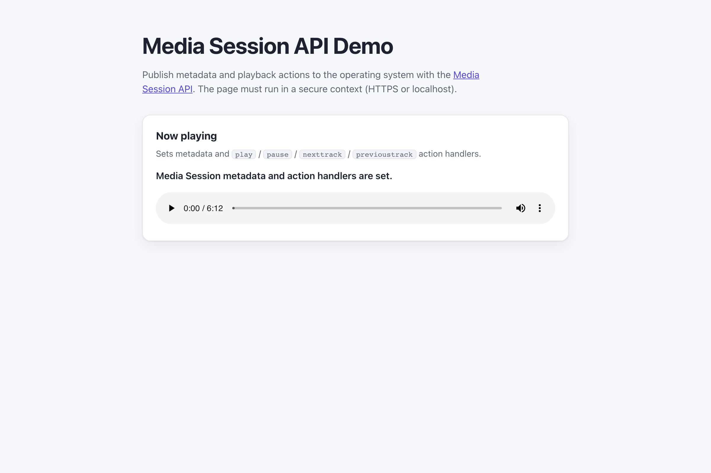

# WebSharper.MediaSession

[](https://github.com/dotnet-websharper/MediaSession)

WebSharper bindings for the [Media Session API](https://developer.mozilla.org/en-US/docs/Web/API/Media_Session_API) —
publishing media metadata and playback actions to the operating system from F# and C# web apps.

The Media Session API is only available in [secure contexts](https://developer.mozilla.org/en-US/docs/Web/Security/Defenses/Secure_Contexts)
(HTTPS or localhost).

This repository contains:

| Project | Purpose |
| --- | --- |
| `WebSharper.MediaSession` | The binding: WIG definitions for `MediaSession`, `MediaMetadata`, `MetadataInit`, `ArtWork`, `ChapterInformation`, `MediaSessionActionDetails`, `MediaPositionState`, and the `PlaybackState` enum. |
| `WebSharper.MediaSession.Extensions` | `[<Inline>]` client extensions: `Navigator.MediaSession`. |
| `WebSharper.MediaSession.Sample` | An ASP.NET Core SPA that plays a track and sets media session metadata. |

## Live demos

**Try it live:** [Open the sample in your browser](https://dotnet-websharper.github.io/MediaSession/)



The sample doubles as the binding's test case: it sets metadata and action handlers, and plays an audio track.

- **Sample (this repository):** <https://dotnet-websharper.github.io/MediaSession/>
- **Source repository:** <https://github.com/dotnet-websharper/MediaSession>
- **WebSharper bindings:** <https://websharper.com/bindings>

## Features

- `MediaSession.metadata` and `MediaSession.playbackState`.
- `MediaSession.setActionHandler()` for `play`, `pause`, `nexttrack`, `previoustrack`, `seekto`, and the other actions.
- `MediaMetadata` with `title`, `artist`, `album`, `artwork`, and `chapterInfo`.
- `ArtWork` (`src`, `sizes`, `type`) and `ChapterInformation`.
- `MediaSession.setPositionState()` and `MediaPositionState`.
- `MediaSession.setCameraActive()` / `setMicrophoneActive()`.

## Installation

The binding is not currently published to NuGet. Reference the projects from source:

```bash
git clone https://github.com/dotnet-websharper/MediaSession.git
```

```xml
<ItemGroup>
  <ProjectReference Include="path/to/WebSharper.MediaSession/WebSharper.MediaSession.fsproj" />
  <ProjectReference Include="path/to/WebSharper.MediaSession.Extensions/WebSharper.MediaSession.Extensions.fsproj" />
</ItemGroup>
```

## Usage

```fsharp
namespace WebSharper.MediaSession.Demo

open WebSharper
open WebSharper.JavaScript
open WebSharper.MediaSession

[<JavaScript>]
module Demo =
    let audio = JS.Document.GetElementById("audio") |> As<HTMLAudioElement>

    let setupMediaSession () =
        let navigator = JS.Window.Navigator

        if not (isNull navigator.MediaSession) then
            let metadata =
                new MediaMetadata(MetadataInit(
                    Title = "SoundHelix Song",
                    Artist = "Composer Name",
                    Album = "Sample Album",
                    Artwork = [| ArtWork(Src = "cover.png", Sizes = "96x96", Type = "image/png") |]
                ))

            navigator.MediaSession.Metadata <- metadata

            navigator.MediaSession.SetActionHandler("play", fun (_: MediaSessionActionDetails) ->
                audio.Play() |> ignore
                navigator.MediaSession.PlaybackState <- PlaybackState.Playing
            )

            navigator.MediaSession.SetActionHandler("pause", fun (_: MediaSessionActionDetails) ->
                audio.Pause() |> ignore
                navigator.MediaSession.PlaybackState <- PlaybackState.Paused
            )
```

The `Navigator.MediaSession` extension is declared in the Extensions assembly. The `PlaybackState` enum is exposed
as `PlaybackState.Playing`, `PlaybackState.Paused`, and `PlaybackState.None`.

## Running the sample

Build the sample in Release and serve its static output:

```bash
dotnet build WebSharper.MediaSession.Sample/WebSharper.MediaSession.Sample.fsproj -c Release
python3 -m http.server -d WebSharper.MediaSession.Sample/wwwroot 8099
```

Open <http://localhost:8099/> and press play. The operating system's media controls (where available) should show
the track metadata and the play/pause actions.

Alternatively, run the ASP.NET Core host:

```bash
dotnet run --project WebSharper.MediaSession.Sample
```

## Building from source

### Prerequisites

- [.NET SDK 10](https://dotnet.microsoft.com/download) or later.

### Build

```bash
dotnet build WebSharper.MediaSession.sln -c Release
```

The binding projects target `netstandard2.0`; the sample targets `net10.0`.

## Deployment

Pushing to `main` triggers `.github/workflows/ghpages.yml`, which builds the sample in Release and publishes
`WebSharper.MediaSession.Sample/wwwroot` to the `gh-pages` branch.

## Repository layout

```
WebSharper.MediaSession/              # binding (WIG definitions)
  Main.fs
WebSharper.MediaSession.Extensions/   # [<Inline>] client extensions
  Library.fs
WebSharper.MediaSession.Sample/       # ASP.NET Core SPA demo
  Client.fs
  Startup.fs
  wwwroot/
    index.html
    site.css
.github/workflows/ghpages.yml         # build + deploy the sample to GitHub Pages
```

## Notes on the API

- **Secure context:** `navigator.mediaSession` is only exposed in secure contexts. Serve the page over HTTPS or
  from localhost.
- **Metadata:** `MediaMetadata` is a `MediaMetadata` object with `title`, `artist`, `album`, `artwork`, and
  `chapterInfo`. Set it to `navigator.mediaSession.metadata`.
- **Action handlers:** `setActionHandler` accepts the action name and a callback that receives a
  `MediaSessionActionDetails`. Set `playbackState` to keep the system controls in sync.
- **Browser support:** the Media Session API is available in Chromium-based browsers; the metadata and actions
  are not shown on every platform.

## License

Apache 2.0 — see [LICENSE.md](LICENSE.md).
